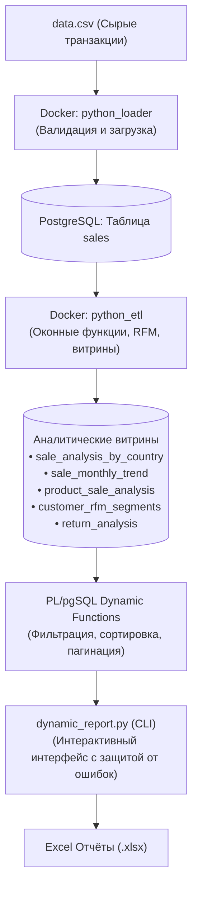

# 🛒 E-Commerce ELT Pipeline & Dynamic Analytics Platform

Комплексный аналитический проект: автоматизированный контейнеризированный пайплайн обработки данных интернет-магазина (Online Retail Dataset) с загрузкой в PostgreSQL, расчетом аналитических витрин на SQL, PL/pgSQL функциями и интерактивным генератором отчётов на Python с экспортом в Excel.

---

## 🏗 Архитектура проекта



---

## 📊 Аналитические витрины и отчеты

1. **Сводка продаж по странам (`sale_analysis_by_country`):**
   * Общая выручка, средний чек, количество уникальных клиентов и товаров.
   * Активные дни/месяцы, доля страны в глобальной выручке, процент возвратов.
2. **Динамика продаж по месяцам (`sale_monthly_trend`):**
   * Выручка по месяцам, динамика MoM (Month-over-Month) в % через оконную функцию `LAG`.
   * Коэффициент привлечения новых клиентов (`adoption_of_new_clients`).
3. **Товарная аналитика (`product_sale_analysis`):**
   * Топ-товары по выручке и количеству проданных единиц в разрезе стран.
   * Доля конкретного товара в выручке страны (`revenue_share_in_country`).
4. **RFM-сегментация клиентов (`customer_rfm_segments`):**
   * Расчет метрик **Recency** (давность последней покупки относительно максимума датасета), **Frequency** (число заказов), **Monetary** (общие траты).
   * Сегментация через `NTILE(3)` на категории: *VIP, Лояльный, Новый, Постоянный, Спящий, Потерянный*.
5. **Анализ возвратов (`return_analysis`):**
   * Доля возвратов по каждому товару и стране (`return_rate_percent`).
   * Оценка упущенной выручки из-за возвратов (`revenue_lost_from_returns`).

---

## 🛠 Стек технологий

* **База данных:** PostgreSQL 16 (PL/pgSQL, Window Functions, CTE, Dynamic SQL `EXECUTE format(...)`).
* **Контейнеризация и оркестрация:** Docker, Docker Compose (настройка healthcheck, последовательный запуск по зависимостям `condition: service_completed_successfully`).
* **Python 3.10+:**
  * `Pandas` — предобработка данных, векторизованная валидация, генерация отчетов.
  * `SQLAlchemy 2.0` — взаимодействие с PostgreSQL.
  * `OpenPyXL` — форматирование и сохранение в Excel.
* **Автоматизация:** Bash (`run.sh`) — очистка volumes, сборка образов, ожидание БД и запуск пайплайна в одну команду.

---

## 🚀 Быстрый старт

### 1. Требования
* Установленный **Docker** и **Docker Compose**.
* Python 3.9+ (рекомендуется локальное виртуальное окружение `.venv`).

### 2. Клонирование и настройка окружения
```bash
git clone https://github.com/your-username/petik.git
cd petik

# Создайте файл с переменными окружения из примера:
cp .env.example .env
```

### 3. Запуск всего проекта одной командой
В корне проекта выполните скрипт автоматизации:
```bash
./run.sh
```

**Что делает `run.sh`:**
1. Очищает старые контейнеры и данные (`docker compose down -v`).
2. Собирает Docker-образы для загрузчика и ETL.
3. Запускает PostgreSQL и дожидается прохождения healthcheck.
4. Запускает `python_loader` (загружает CSV в базу).
5. Запускает `python_etl` (строит аналитические витрины).
6. Запускает интерактивную консоль `dynamic_report.py`.

---

## 🖥 Интерактивный генератор отчетов (`dynamic_report.py`)

Инструмент снабжен надежной «защитой от дурака»:
* **Автодополнение и нечеткий поиск:** регистронезависимый ввод стран и сегментов (например, `brazil` -> `Brazil`, `Bra` -> `Brazil`), автоматическое удаление случайных кавычек и запятых.
* **Валидация диапазонов:** процентные ставки ограничены `0..100%`, суммы и количества `>= 0`.
* **Защита дат:** проверка формата `ГГГГ-ММ-ДД` и корректности интервалов (дата конца не может быть раньше даты начала).
* **Безопасная сортировка:** выбор только из разрешенных колонок витрины.
* **Результат:** сохранение кастомизированного отчёта в Excel с информированием о числе выгруженных строк.

---

## 📁 Структура репозитория

```text
├── docker-compose.yaml     # Описание сервисов (postgres, loader, etl)
├── run.sh                  # Единый bash-скрипт запуска проекта
├── .env.example            # Пример конфигурации переменных окружения
├── .gitignore              # Исключения Git (кэш, .venv, секреты, .xlsx)
├── loader/                 # Загрузка первичных данных
│   ├── fromCSVtoDB.py      # Скрипт загрузки CSV в PostgreSQL
│   ├── Dockerfile
│   └── requirements.txt
├── etl/                    # Трансформация данных и расчет витрин
│   ├── etl.py              # SQL-трансформации и создание витрин
│   ├── Dockerfile
│   └── requirements.txt
└── dynamic_report/         # Интерактивный генератор аналитических отчетов
    ├── dynamic_report.py   # Консольный интерфейс с валидацией
    ├── requirements.txt
    └── data/               # PL/pgSQL функции генерации отчетов
        ├── customer_rfm_segments_report.sql
        ├── product_sale_analysis_report.sql
        ├── return_analysis_report.sql
        ├── sale_analysis_by_country_report.sql
        └── sale_monthly_trend_report.sql
```
